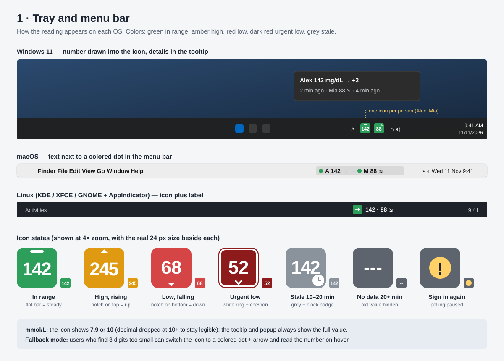
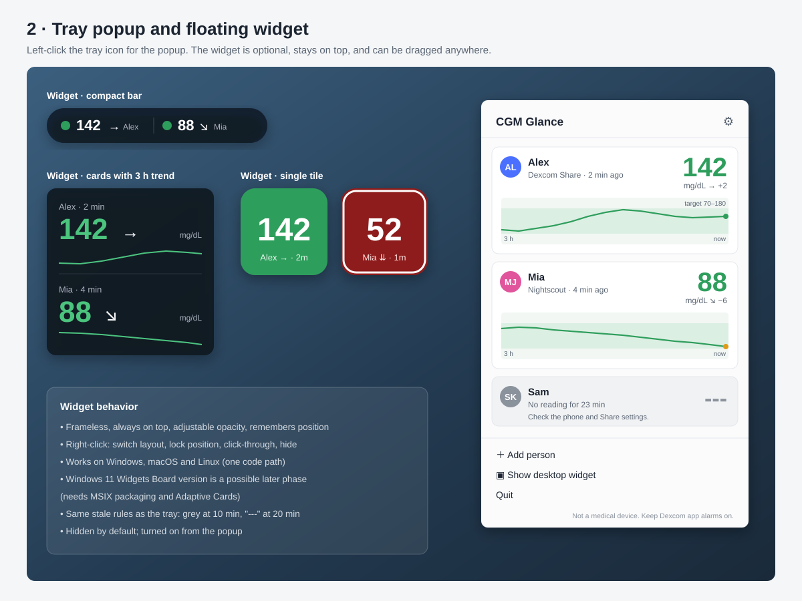
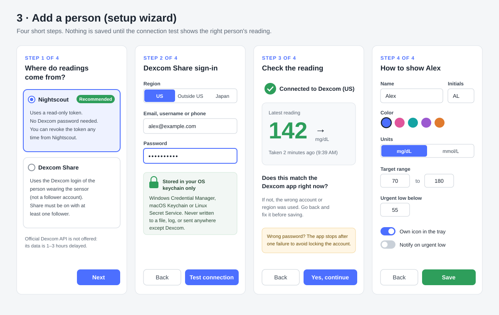

# CGM Glance

A lightweight tray / menu-bar app for Windows, macOS and Linux that shows the current
Dexcom glucose reading for one or more people with T1D, with an optional floating widget.

> **Status:** planning. No code yet. See [docs/PLAN.md](docs/PLAN.md).

> **Not a medical device.** CGM Glance shows readings at a glance. It does not replace the
> Dexcom app or its alarms. Never make treatment decisions from it alone.

## Prototypes

